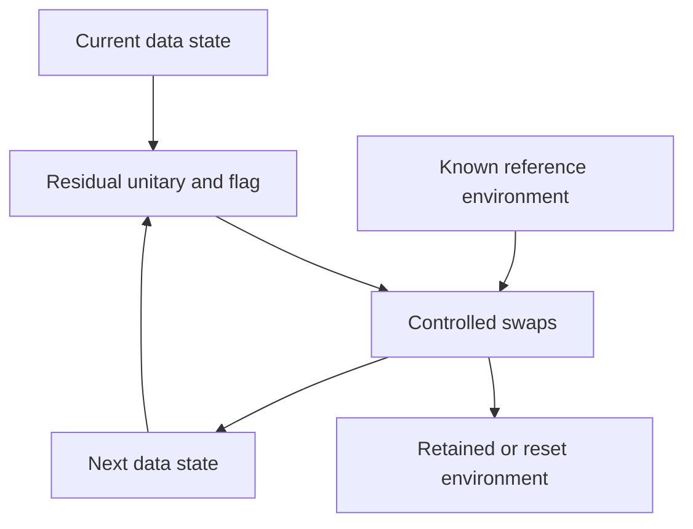

# Recurrent quantum inversion without classical iterate feedback

This prototype addresses a different requirement from a single inverse-action
circuit: retain a quantum data state and repeatedly drive it toward a solution,
without measuring that state, updating its amplitudes on a CPU, or preparing a
classically corrected state between iterations.

The implementation is in `src/qcenn_mi/recurrent_quantum.py`. It is a quantum
collision channel with a known reference state. It is separate from the
input-independent Chebyshev–LCU inverse operator and from the hybrid QCeNN
tracker. It has no trainable neural weights. Chebyshev/QSVT acceleration of this
channel is not implemented.

## What stays on the quantum device

1. Prepare the initial data state once.
2. Apply a unitary block encoding of the residual to the current data register
   and a fresh flag.
3. Use controlled swaps to transfer the residual branch into an environment and
   replace that branch by a known reference state. These are quantum gates,
   without a measurement-conditioned classical update.
4. Repeat on the same data register for a predetermined number of updates.
5. Measure the data only after the final update, or pass the output to another
   quantum computation.

The two workspace choices implement the same reduced data-state channel:

| Mode | Environment handling | Intermediate measurements | Classical iterate updates |
|---|---|---|---|
| `coherent` | Retain a fresh quantum environment for each update | None | None |
| `reset` | Reset and reuse auxiliary qubits on the device | No explicit circuit measurements; reset is a dissipative device operation | None |

The `coherent` mode is a fully unitary circuit until final readout. Its data
register converges as a reduced state; information about the initial state stays
in the growing environment. The entire closed-system state does not contract.
The `reset` mode discards that environment on the device. It is not a closed
unitary computation, but it does not send the iterate to a classical solver.



## Construction and convergence

Assume a real nonsingular square matrix and a nonzero real right-hand side.
Write

\[
 A=M/\|M\|_2,\qquad a=\sigma_{\min}(M)/\|M\|_2=1/\kappa,
 \qquad |b\rangle=b/\|b\|_2.
\]

Add one reference coordinate `r=N` and pad the register to a power of two. The
residual operator is

\[
 F=\frac1{\sqrt{1+a^2}}
 \begin{bmatrix}
 A&-a|b\rangle&0\\
 0&0&0\\
 0&0&I_{\rm padding}
 \end{bmatrix}.
\]

Its unique null state is

\[
 |\Psi\rangle=
 \frac{(aA^{-1}|b\rangle,\,1,\,0_{\rm padding})^{\mathsf T}}
 {\sqrt{1+a^2\|A^{-1}|b\rangle\|^2}}.
\]

This formula identifies the target for analysis. **The circuit constructor does
not compute or load this target.** It constructs `F` from `M`, `b`, and singular
value bounds, then synthesizes a dense unitary dilation. Classical inverse and
solve calls are used only by independent benchmark/test oracles.

Let `C=sqrt(I-F†F)`. The collision unitary is

\[
 U_F=\begin{bmatrix}C&-F^\dagger\\F&\sqrt{I-FF^\dagger}\end{bmatrix}.
\]

Prepare the environment in `|r>` and the flag in zero. After `U_F`, controlled
swaps reset the residual branch to `|r>` while retaining the displaced quantum
state in the environment. Tracing the environment only for analysis gives

\[
 \mathcal E(\rho)=C\rho C^\dagger+
 \operatorname{Tr}(F\rho F^\dagger)|r\rangle\langle r|.
\]

This map is completely positive and trace preserving. It performs no rejection
or postselection between updates. The target is fixed because `F|Psi>=0`.

For completeness, the nonzero eigenvalues of `G=F†F` are at least
`g=a²/(1+a²)`: the nonzero singular values of `[A,-a|b>]` are bounded below by
those of `A`, and the padding block has singular value one before scaling. Also,
`q=|<r|Psi>|² >= 1/2`. With `p_k=<Psi|rho_k|Psi>`,

\[
 p_{k+1}=p_k+q\operatorname{Tr}(G\rho_k),\qquad
 1-p_{k+1}\le
 \left(1-\frac{a^2}{2(1+a^2)}\right)(1-p_k).
\]

Thus the ideal channel converges from **any initial data density matrix**. From
the default reference initial state, the initial infidelity is at most `1/2`.
The trace distance to the pure target is at most the square root of this
infidelity bound. This is a conservative static-matrix certificate. The update
count grows as `O(kappa² log(1/epsilon))` for a fixed augmented-state accuracy;
no advantage over optimal quantum solvers is claimed.

Final restriction to the first `N` coordinates yields a state proportional to
`M⁻¹b`. Its limiting extraction probability is between `1/(kappa²+1)` and
`1/2`. Augmented-state fidelity and conditional solution fidelity are different
metrics and are both reported. Returning a complete signed classical vector or
inverse matrix requires additional final measurements and scale information.

## Running and exporting the circuit

```python
from qiskit import transpile
from qcenn_mi.recurrent_quantum import build_recurrent_solver

solver = build_recurrent_solver([[2.0, 0.4], [-0.1, 1.5]], [1.0, -0.5])

# Every environment remains quantum until final readout: 20 qubits here.
closed = solver.circuit(6, workspace="coherent")
native = transpile(closed, basis_gates=["rz", "sx", "x", "cx"],
                   optimization_level=1)

# Same reduced data dynamics using device resets: 5 qubits for any update count.
resident = solver.circuit(64, workspace="reset")
result = solver.simulate(64, workspace="reset")
print(result["coherence_relative_residual"])
```

The printed residual uses final simulator coherences for verification. It is
never used to determine a later gate, stopping time, or prepared data state.
Hardware would need final tomography or another suitable measurement protocol
to obtain those coherences.

Run the reproducible campaign with

```bash
python -m qcenn_mi.recurrent_quantum_benchmark \
  --config configs/full.json --output-dir results/recurrent-quantum
```

It exports native/reset and coherent QPY circuits, final Z counts, a convergence
plot, JSON evidence, and a summary. Prefix experiments independently validate
convergence. They are not an adaptive classical loop within the solver.

## Time-varying inputs

`recurrent_circuit([(first_solver, steps1), (second_solver, steps2)])` changes the
residual gates while retaining the same data register. The tested sequence is
preprogrammed. No classical state extraction occurs at the transition.

Unknown future matrix values still require a physical input interface or a
quantum oracle. A preprogrammed sequence is not autonomous live acquisition.
When the target moves continuously, the objective is tracking with a finite
error, rather than convergence to a single final state. Static contraction
bounds cannot be quoted as a validated temporal or noise certificate.

## Width, depth, and noise

For `n=ceil(log2(N+1))` data qubits and `K` updates, coherent width is
`n+K(n+1)`; reset width is `2n+1`.

| Matrix order | Data qubits | Fully coherent, 64 updates | Device resets, 64 updates |
|---|---|---|---|
| 2 | 2 | 194 | 5 |
| 10 | 4 | 324 | 9 |
| 100 | 7 | 519 | 15 |
| 1000 | 10 | 714 | 21 |

The order-100/1000 entries are **width estimates only**. Reset width can fit a
42-qubit device while dense gate synthesis, update count, reset errors, final
extraction probability, and readout remain prohibitive. For example, the
order-2 native circuit at 32 updates already contains more than 1000 CX gates.
The full campaign reports synthetic CX-only noise separately from software
correctness; reset, one-qubit, and readout errors are ideal in that noise model.
No physical QPU job is submitted by this implementation.

Dense gate compilation performs classical SVDs and is guarded by a small
encoding-dimension budget. Efficient coherent input access and quantum
polynomial synthesis are future work. Keeping the iterate quantum does not
remove these input and compilation costs.

## Relationship to prior work

The use of dissipation or eigenstate filtering to obtain a quantum solution is
established, rather than a new claim of this repository:

- Verstraete, Wolf, and Cirac, [Quantum computation and quantum-state engineering
  driven by dissipation](https://doi.org/10.1038/nphys1342), *Nature Physics*, 2009.
- Lin and Tong, [Optimal polynomial based quantum eigenstate filtering with
  application to solving quantum linear systems](https://doi.org/10.22331/q-2020-11-11-361),
  *Quantum* 4, 361, 2020.
- Shang, [A Simple Quantum Linear-System Solver via Dissipation](https://arxiv.org/abs/2609.12284),
  September 2026 preprint. Its abstract describes a dissipative fixed-point
  solver; this prototype is not presented as a reproduction of its full algorithm.

The present addition is an explicit, independently checked dense collision
circuit and a comparison of coherent environment retention with device resets.
It does not retroactively convert the existing Chebyshev simulation evidence
into a demonstrated recurrent neural network or a hardware result.
