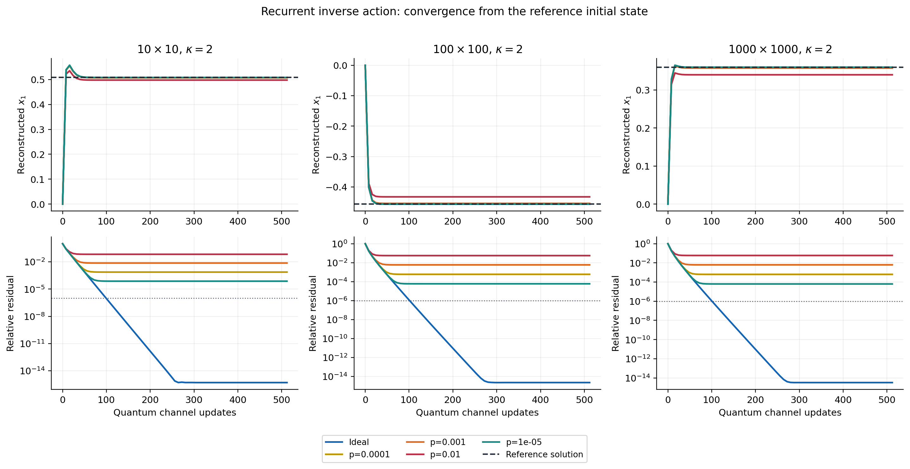
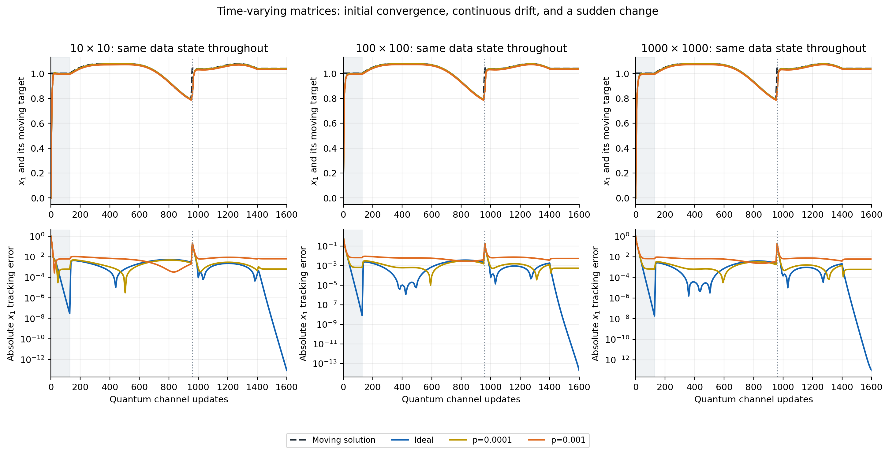
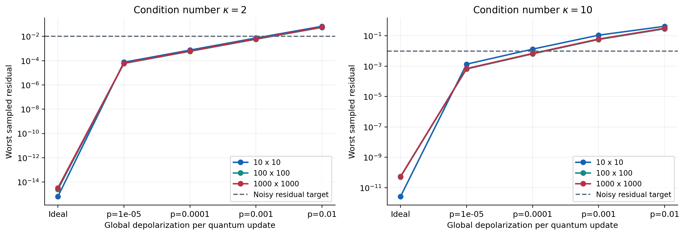

# Recurrent quantum inverse-action scaling study

**Execution:** exact reduced-density quantum-channel simulation at orders 10, 100, 1000, with independent complete-circuit checks through order 10. This is not physical hardware execution or a native-gate simulation of the order-100/1000 circuits.

Source commit: `807c9534c8f9119f427555c6dc3eef2ab52aceb2`.
Source SHA-256: `58caaa34ea6bd26032e4be32f569bb433ed3124e0a8efe8d2266b2dccc7ec214`.

Static/noisy trajectories: 129; dynamical trajectories: 9; complete-circuit comparisons: 6.

Main ideal accuracy targets passed: 54/54. Noisy accuracy targets passed: 42/72. Failures are retained; the numerical-integrity verdict is a separate quantity.

## Final residuals

Worst sampled relative residual, not a guarantee over all matrices or right-hand sides.

| Order | Condition | Ideal: all three RHS | p=0.0001, random RHS | p=0.001, random RHS | p=0.01, random RHS |
|---|---|---|---|---|---|
| 10 | 2 | 8.955e-16 | 7.449e-04 | 7.386e-03 | 6.820e-02 |
| 10 | 10 | 1.389e-10 | 1.334e-02 | 1.106e-01 | 4.256e-01 |
| 100 | 2 | 2.843e-15 | 5.912e-04 | 5.877e-03 | 5.546e-02 |
| 100 | 10 | 1.088e-10 | 6.498e-03 | 5.757e-02 | 2.919e-01 |
| 1000 | 2 | 3.908e-15 | 6.315e-04 | 6.276e-03 | 5.907e-02 |
| 1000 | 10 | 7.382e-11 | 6.937e-03 | 6.171e-02 | 3.147e-01 |

## Figures

Reduced-density simulations, nonsymmetric condition-2 fixtures and signed random right-hand sides. x1 is reconstructed from solution/reference coherences. p is global depolarization per update, not a gate error. Noisy lines are ensemble means.

M(k)=M(0)G(theta(k)) rotates two columns at condition number 2. The state is not reinitialized. Shading marks initial settling; the dotted line marks a jump at update 960. Matrix values are preprogrammed. The final segment holds the matrix constant. x1 uses simulator coherences, not a measured signal.

Worst final residual over the three matrix families for the signed random RHS. Different iteration budgets are used at condition numbers 2 and 10. The profiles are logical depolarization, not native CX noise or calibrated hardware data.

## Conditioning stress probes

| Order | Condition | Updates | Final residual | Accuracy target met |
|---|---|---|---|---|
| 10 | 100 | 4096 | 4.825e-01 | False |
| 100 | 100 | 4096 | 2.498e-01 | False |
| 1000 | 100 | 4096 | 2.677e-01 | False |

## Interpretation and reproduction

The recurrent state is a density matrix of the augmented solution/reference register. Every update is the same quantum channel as the complete collision circuit. In the spectral basis, C is diagonal, so a reduced update needs O(P²) arithmetic/storage. This reduces classical simulator work; it is not a quantum speedup result.

The input matrices and RHS vectors are archived as NPZ files with digests. Classical references are used only by read-only diagnostics. The simulator does not feed an estimated solution, fitted scale, or classical residual correction into its next state.

Logical noise is global depolarization on the padded data register once per update: rho -> (1-p)rho + p I/P. Its p is not comparable with a CX gate error rate. The separately supplied small native CX-noise results remain a different experiment.

The absolute x1 estimate uses solution/reference coherences and known input scaling. A physical implementation would need final measurements to estimate them. Recording these values along a simulator trajectory does not imply continuous, non-destructive readout on hardware.

The dynamic family changes two columns at constant conditioning. A manufactured initial solution defines the benchmark RHS; it is not supplied to the channel. Independent linear solves check the reference. A preprogrammed angle sequence is not autonomous acquisition of unknown matrices.

RHS-dependent inverse action is tested on basis, uniform and signed random inputs; the experiment does not reconstruct every column of a 1000×1000 inverse or certify all nonsingular inputs. Finite-step/noisy accuracy failures remain part of the data.

Run: `python -m qcenn_mi.recurrent_scaling_benchmark --config configs/full.json --output-dir NEW_DIRECTORY`. Complete data are in `result.json` and the three CSVs.

## Limits

- Large runs are reduced-density quantum-channel simulations, not QPU/native-gate runs.
- Logical update noise is not a hardware gate error or calibrated device noise model.
- Dense classical input SVDs remain part of compilation; no speedup is measured.
- RHS-dependent encodings do not audit an input-independent inverse operator.
- x1 uses simulator coherences; hardware would require additional measurements.
- Dynamic matrices rotate two columns at fixed conditioning; inputs are preprogrammed.
- Noise, high-conditioning and transient accuracy failures are retained.
